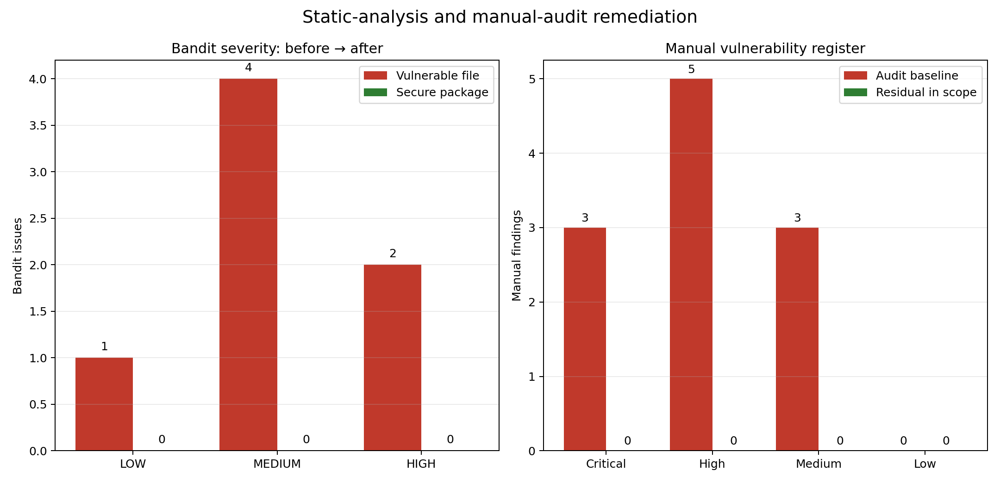
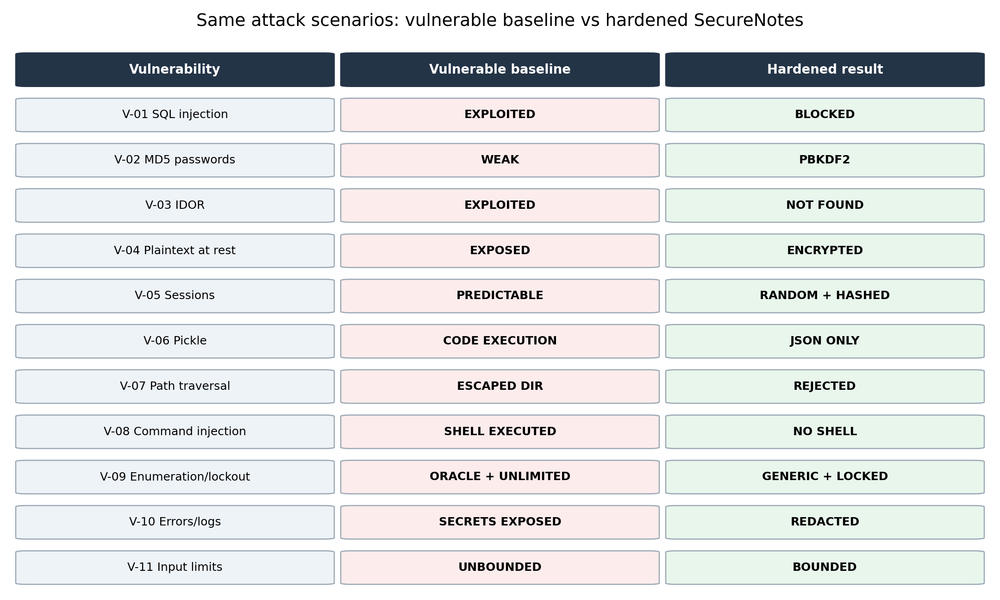
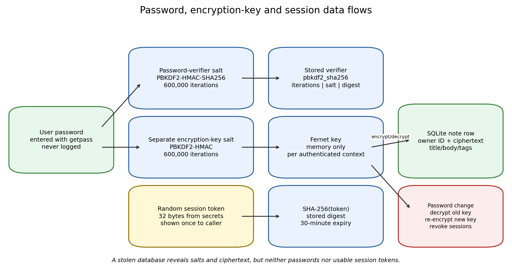

# SecureNotes security audit report

## Executive summary

The Week 5 task was to review a Python application that accepts user input and
stores sensitive data, exploit its weaknesses in a controlled local setting,
harden it without removing its features, and prove that the same attacks no
longer work.

The audited concept is **SecureNotes**, a local SQLite notes CLI with user
accounts, sessions, private notes, JSON import/export and database backup.
The original implementation is retained only as
`vulnerable/vulnerable_app.py`; the deliverable application is the separate
`securenotes/` package.

### Result in one page

| Audit measure | Before | After |
|---|---:|---:|
| Vulnerability classes in manual register | 11 | 11 addressed |
| Critical / High / Medium manual findings | 3 / 5 / 3 | 0 known in-scope residual findings |
| Bandit issues | 7 in quarantined baseline | 0 unsuppressed in secure package |
| Attack-demo vulnerability outcomes | 13/13 exploitable or exposed | 13/13 blocked or protected |
| Legitimate attack-demo workflows | insecure success | 2/2 secure success |
| Automated tests | — | 58 passed |
| Password verifier | unsalted MD5 | PBKDF2-HMAC-SHA256, salt, 600,000 iterations |
| Note storage | plaintext | Fernet ciphertext |
| Session storage | raw predictable token | SHA-256 digest of a 256-bit random token |

The most important audit lesson is that **a scanner result is not a security
review**. Bandit correctly found several dangerous constructs, but the
highest-impact application flaw—one authenticated user reading another user's
note by changing an ID—required understanding the ownership rule. Conversely,
not every scanner candidate was a vulnerability: the string
`"pbkdf2_sha256"` is a public algorithm label, not a hard-coded password, and
was explicitly triaged rather than blindly “fixed.”

## 1. Scope and method

### 1.1 Artefacts reviewed

- `vulnerable/vulnerable_app.py` — baseline authentication, SQL, sessions,
  note storage, import/export, backup, logging and errors.
- `securenotes/` — hardened implementation.
- `tests/` — functionality, security and quarantined attack tests.
- `tools/attack_demo.py` — paired before/after attack harness.
- `results/security_scans/` — Bandit JSON/text output.
- `docs/evidence/` — generated transcripts and figures.

### 1.2 Review steps

1. **Model the application.** Identify assets (passwords, keys, tokens, notes,
   exports, backups and audit rows), actors and trust boundaries.
2. **Read the data flows.** Follow each externally controlled value from CLI or
   file input to SQL, cryptography, filesystem, OS and output.
3. **Run static analysis.** Execute Bandit 1.9.4 against the baseline and the
   hardened package.
4. **Exploit safely.** Use temporary databases, synthetic secrets and harmless
   marker files. No network target or real credential was involved.
5. **Harden by design.** Prefer removing an unsafe boundary (pickle/shell) to
   trying to sanitize arbitrary input for it.
6. **Regression-test both directions.** Baseline attack tests assert that the
   old exploit works; secure tests assert that it fails *and* the legitimate
   action still succeeds.
7. **Re-scan and re-run.** Repeat Bandit, all 58 tests and the paired attack
   demo.

### 1.3 Severity scale

- **Critical:** authentication bypass or arbitrary code/command execution.
- **High:** direct private-data disclosure or durable credential/session
  compromise.
- **Medium:** account discovery, unlimited online guessing, sensitive
  secondary disclosure or practical resource abuse.
- **Low:** narrow metadata/usability weakness.

These are contextual teaching-project ratings, not formal CVSS vectors.

## 2. Vulnerability register

| ID | Finding | CWE | Baseline severity | Disposition |
|---|---|---|---:|---|
| V-01 | SQL injection in login and search | CWE-89 | Critical | Fixed: bound parameters/no user SQL |
| V-02 | Unsalted, fast MD5 password storage | CWE-916, CWE-327 | High | Fixed: salted PBKDF2-HMAC-SHA256 |
| V-03 | Broken access control / insecure direct object reference | CWE-862, CWE-639 | High | Fixed: owner predicate on every note operation |
| V-04 | Sensitive notes stored in plaintext | CWE-311, CWE-312 | High | Fixed: password-derived Fernet encryption |
| V-05 | Predictable, raw, non-expiring sessions | CWE-338, CWE-613 | High | Fixed: random, hashed, expiring, revocable sessions |
| V-06 | Deserialization of untrusted pickle data | CWE-502 | Critical | Fixed: bounded/schema-validated JSON only |
| V-07 | Path traversal in export filename | CWE-22 | High | Fixed: safe basename + resolved parent check |
| V-08 | OS command injection in backup filename | CWE-78 | Critical | Fixed: shell removed; SQLite backup API |
| V-09 | Account enumeration and unlimited password guesses | CWE-204, CWE-307 | Medium | Fixed: generic failures, dummy work, lockout |
| V-10 | Sensitive data in errors and logs | CWE-209, CWE-532 | Medium | Fixed: safe errors and redacted audit metadata |
| V-11 | Missing input/resource limits | CWE-20, CWE-400 | Medium | Fixed: allow-lists, bounds and schema checks |





---

## 3. Detailed findings

## V-01 — SQL injection in authentication and search

**CWE:** CWE-89  
**Baseline severity:** Critical  
**Baseline locations:** `VulnerableNotesApp.login`,
`VulnerableNotesApp.search_notes`  
**Hardened locations:** `AuthService.authenticate`, `Database.execute`,
`NoteService.search_notes`

### What was wrong

The baseline constructed SQL by f-string:

```python
# Quarantined baseline pattern (abbreviated — do not copy)
query = (
    "SELECT * FROM users "
    f"WHERE username = '{username}' "
    f"AND password_md5 = '{self._md5(password)}'"
)
```

SQL does not know which apostrophes came from the programmer and which came
from the caller. User text therefore crosses from the *data plane* into the
*command plane* of the database.

### Worked exploit

With a real account `alice`, submit:

```text
username: alice' --
password: wrong
```

The effective predicate becomes approximately:

```sql
WHERE username = 'alice' --' AND password_md5 = '...'
```

Everything after `--` is a comment, including the password condition. SQLite
returns Alice's row and the baseline issues a session despite the wrong
password. The paired transcript records:

```text
Baseline: EXPLOITED: login succeeded with the wrong password
Hardened: BLOCKED (AuthenticationError: Invalid username or password.)
```

A second payload against baseline search, `' ) OR 1=1 --`, changes operator
grouping so a request made for user 999 returns Alice's note. An early version
of my test payload, `' OR 1=1 --`, produced an incomplete SQL statement
because it commented out a closing parenthesis. That mistake was useful: it
showed why an attack transcript must demonstrate the final query semantics,
not merely paste a generic injection string.

### Impact

- Complete authentication bypass for a known username.
- Cross-account search disclosure.
- Potential data manipulation in applications where injected statements or
  subqueries can reach more powerful SQL operations.

### Fix and rationale

All SQL values are bound with `?` parameters. Conceptually:

```python
row = db.execute(
    "SELECT ... FROM users WHERE username = ?",
    (clean_username,),
).fetchone()
```

SQLite receives the query structure and value separately, so punctuation in
the value cannot alter the parse tree. Username validation is retained as a
usability/defence-in-depth layer, but security does not depend on filtering
quotes.

Secure note text is encrypted, so SQL `LIKE` cannot search it without first
decrypting rows. `NoteService.search_notes` therefore loads only the caller's
rows with a parameterized owner query, decrypts them, and performs a literal
case-insensitive substring test in Python. This removes both SQL injection and
`%`/`_` wildcard surprises. The trade-off is O(number of the user's notes)
search work, acceptable for the local scope and documented as a scaling
limit.

### Evidence

- `tests/test_attack_simulations.py::test_baseline_sql_injection_bypasses_login`
- `tests/test_attack_simulations.py::test_baseline_search_injection_crosses_user_boundary`
- `tests/test_auth_security.py::test_sql_injection_login_payloads_fail`
- `tests/test_notes_security.py::test_search_payloads_are_treated_literally`
- Attack rows V-01a and V-01b in `docs/evidence/attack_demo.md`
- Bandit B608 findings (3) in the baseline; none in `securenotes/`

### Residual risk

Bound parameters protect values, not dynamically selected table/column names.
SecureNotes does not accept caller-selected SQL identifiers, so that residual
class is outside the implemented feature set.

---

## V-02 — Unsalted MD5 password storage

**CWE:** CWE-916 (insufficiently protected password hash), CWE-327 (broken/risky
cryptography)  
**Baseline severity:** High  
**Baseline location:** `VulnerableNotesApp._md5`  
**Hardened locations:** `crypto.hash_password`, `crypto.verify_password`

### What was wrong

The baseline stored `MD5(password)`. For the synthetic password `password`,
the database value is the instantly recognizable:

```text
5f4dcc3b5aa765d61d8327deb882cf99
```

Three separate problems combine:

1. MD5 is extremely fast, which is desirable for checksums but harmful for
   password guessing.
2. There is no salt, so identical passwords produce identical records and one
   precomputation/dictionary result applies to every account.
3. The stored value is directly comparable to public password-hash lists.

### Impact

A disclosed database can be attacked offline at very high speed. Because the
same password also protects note data in the functional design, recovering it
compromises both identity and content.

### Fix and rationale

Passwords are hashed with PBKDF2-HMAC-SHA256:

- 16-byte random salt per password record;
- 600,000 iterations;
- self-describing storage format:
  `pbkdf2_sha256$iterations$salt$digest`;
- `hmac.compare_digest` for the digest comparison;
- malformed/tampered records fail closed.

Storing the algorithm and iteration count is deliberate: parameters can be
raised later and verified per record during migration. A per-password random
salt means two records for the same password differ.

I considered claiming Argon2id as automatically “better.” It is an excellent
modern password KDF, but adding another dependency and tuning memory/time
parameters was not necessary to satisfy the local scope. PBKDF2-HMAC-SHA256 at
600,000 iterations is a recognized, available-through-standard/cryptography
stack choice. The audit records the option rather than disguising a dependency
decision as a cryptographic proof.

### Evidence

- Baseline asserts the exact MD5 of `password`.
- `test_password_hash_is_salted_pbkdf2_and_verifiable` verifies format,
  different salts, correct password acceptance and wrong-password rejection.
- `test_password_hash_tampering_fails` changes the final character and expects
  verification failure.
- Bandit B324 in baseline; no corresponding secure-package finding.

### Residual risk

PBKDF2 slows, but does not prevent, guessing a weak/reused password. The
minimum 12-character, three-class policy and encryption-key derivation share
that limit.

---

## V-03 — Broken access control / IDOR

**CWE:** CWE-862 (missing authorization), CWE-639 (authorization bypass through
user-controlled key)  
**Baseline severity:** High  
**Baseline location:** `VulnerableNotesApp.get_note(note_id)`  
**Hardened location:** every public method in `NoteService`

### What was wrong

The baseline API accepted only a note ID:

```python
# Baseline shape
get_note(note_id)
```

It had no authenticated caller and no ownership predicate. Knowledge or a
guess of a sequential integer was enough to read the note. This is not fixed
by encryption choices or stronger passwords: an authorized request for the
wrong object is still the wrong object.

### Worked exploit

1. Alice creates note 1 containing `BASELINE-SECRET`.
2. Any caller invokes `get_note(1)`.
3. The baseline returns Alice's title/body.

In the hardened API, Bob must present his own `AuthContext`; the query is
owner-scoped:

```sql
SELECT ... FROM notes WHERE id = ? AND user_id = ?
```

Bob receives `NotFoundError: Note not found.` The same predicate is applied to
update and delete, and list/search/export begin with only the caller's rows.

### Why “not found” rather than “belongs to someone else”?

A distinct “exists but forbidden” answer would reveal valid note IDs. By
returning the same result for foreign and missing notes, SecureNotes avoids
turning the error channel into an object-existence oracle. Internally, an
audit event records a not-found attempt without note content.

### Impact prevented

- Cross-account reading, modification and deletion.
- Enumeration of which sequential IDs exist.
- Accidental future CLI bugs becoming authorization bypasses, because the
  service/database predicate remains the enforcement point.

### Evidence

- Baseline IDOR attack test.
- `test_other_user_cannot_read_update_or_delete_note` covers all three
  mutations/read paths and confirms Alice's original note remains intact.
- `examples/demo.py` prints Bob's failed attempt while Alice's workflows work.
- Attack row V-03.

### Residual risk

The service trusts an `AuthContext` created inside the same process. A hostile
local process that can import and fabricate objects already has code execution
in the application context and is outside the local CLI threat model. A
network version would need server-side session-to-identity binding on every
request.

---

## V-04 — Plaintext sensitive notes at rest

**CWE:** CWE-311 (missing encryption of sensitive data), CWE-312 (cleartext
storage)  
**Baseline severity:** High  
**Baseline locations:** notes table columns `title`, `body`, `tags`  
**Hardened locations:** `crypto.derive_fernet`, `NoteService.create_note`,
`NoteService._decrypt_row`

### What was wrong

Anyone able to copy the baseline SQLite database could use `strings`, a hex
viewer or SQLite itself and recover the complete synthetic secret. My raw-byte
test found `BASELINE-SECRET` directly in `vulnerable.db`.

File permissions help only while the file stays on a correctly configured
system. Databases are copied into backups, archives, crash reports and cloud
folders; the threat model therefore assumes disclosure is possible.

### Fix and design

The title, body and JSON-encoded tags are separately encrypted with Fernet
before insertion. Fernet provides authenticated encryption; tampered
ciphertext fails decryption rather than silently returning altered text.

The key flow is intentionally split:

- password + verifier salt → stored authentication verifier;
- password + separate encryption-key salt → memory-only Fernet key.



Separate salts mean the stored password verifier is not reused as encryption
key material. The database contains the key salt, which is not secret; without
the password it does not produce the key.

Password rotation decrypts each note with the old key, encrypts it with a new
salt/key, replaces the verifier and revokes old sessions. The operations are
wrapped so a database error rolls back rather than leaving half the notes
under the old key and half under the new one.

### Evidence

- Baseline raw DB contains the secret; hardened DB/WAL/SHM byte search does
  not contain title/body/password test strings.
- Wrong-password-derived Fernet cannot decrypt a test note.
- Password-change test proves old password/session fail and the new password
  can still read the original note.
- Attack row V-04 and demo output show stored values begin with a Fernet token
  (`gAAAAA...`), while the owner sees plaintext.

### Alternatives and trade-offs

- **Whole-database SQLCipher** would also encrypt metadata/indexes but adds a
  specialised database dependency and key-management questions.
- **Per-note random data keys** would make key rotation and sharing more
  flexible, at the cost of a more complex envelope-encryption design.
- Field-level Fernet is proportionate here: it protects content and integrates
  naturally with password-derived access, but username/timestamps/counts and
  approximate lengths remain metadata.

### Residual risk

Encryption at rest does not protect plaintext from malware while the
application is running, nor from an attacker who successfully guesses the
password offline.

---

## V-05 — Predictable, raw and non-expiring session tokens

**CWE:** CWE-338 (insufficiently random values), CWE-613 (insufficient session
expiration)  
**Baseline severity:** High  
**Baseline location:** `VulnerableNotesApp.login` and `users.session_token`  
**Hardened locations:** `crypto.new_session_token`, `crypto.token_digest`,
`AuthService._create_session`, `validate_session`, `logout`

### What was wrong

The baseline token was:

```text
session-<user_id>-<current Unix seconds>
```

An attacker who knows a user ID and approximate login time has only a small
set of candidates. Worse, the exact bearer token was stored in the users
table. Database disclosure therefore immediately disclosed a reusable
credential. There was no expiration or purpose-built revocation record.

### Worked evidence

The attack test brackets a login between two calls to `int(time.time())` and
shows that the token's final component is one of those seconds. It then reads
the database and proves `stored_token == bearer_token`.

### Fix

- `secrets.token_urlsafe(32)` supplies 256 bits of token material.
- Only `SHA-256(token)` is stored. A fast hash is appropriate here because the
  token itself is high entropy; this is not a human password.
- Sessions expire after 30 minutes.
- `logout` deletes the digest; unknown tokens receive a quiet result.
- Password change revokes all old sessions.
- CLI accepts the token through a hidden prompt when `--token` is omitted,
  reducing shell-history exposure.

### Evidence

- Two generated tokens differ and are at least 43 URL-safe characters.
- Database digest equals SHA-256 of the bearer token but not the token itself.
- Valid, expired and revoked sessions are separately tested.
- Attack row V-05.

### Residual risk

A bearer token is still sensitive while valid and is printed once at
register/login for the CLI user to retain. It proves identity only; note
commands still require the password to derive the decryption key, limiting
what token theft alone can decrypt in this CLI design.

---

## V-06 — Unsafe pickle deserialization

**CWE:** CWE-502  
**Baseline severity:** Critical  
**Baseline location:** `VulnerableNotesApp.import_pickle`  
**Hardened location:** `NoteService.import_notes`

### What was wrong

Python's pickle format is a small virtual-machine program, not a passive data
format. A crafted object can specify callables to invoke during
deserialization. Calling `pickle.load` on an attacker-supplied file is
therefore close to executing attacker-supplied Python.

### Worked exploit

The canary class returns this reduction conceptually:

```python
(os.system, ("touch <temporary-marker>",))
```

The marker command is harmless and local, but its existence proves the code
path. Baseline import creates the marker before any application-level note
validation could help. If the payload can call `os.system`, the choice of
command belongs to the file author.

### Fix

The feature was redesigned rather than “sanitized”:

- only `.json` files are accepted;
- at most 1,000,000 bytes are read;
- UTF-8/JSON syntax must parse;
- root must provide a bounded note list (maximum 100);
- each object may contain only `title`, `body`, `tags` with validated types;
- inserts occur only after the whole file validates;
- imported text is encrypted under the importing user's key.

The pickle file is rejected by extension/type before its payload is loaded.
The secure marker remains absent. A valid sample JSON import still succeeds.

### Evidence

- Baseline pickle canary test and attack row V-06.
- Secure invalid schema cases include an extra `admin` key, numeric title and
  non-list notes value.
- Pickle-extension and >1 MB tests.
- Bandit B403/B301 in baseline. The *attack tooling/tests* necessarily create
  a canary pickle, but they are not part of the secure runtime package.

### Residual risk

JSON parsers still require size/depth discipline. SecureNotes bounds file
bytes and note count; a hostile deeply nested JSON could consume parser
resources before application schema checks, so a production service should
also consider parser/depth limits at the platform boundary.

---

## V-07 — Path traversal through export filename

**CWE:** CWE-22  
**Baseline severity:** High  
**Baseline location:** `VulnerableNotesApp.export_all_notes`  
**Hardened locations:** `validation.safe_join`, `NoteService.export_notes`

### What was wrong

The baseline joined an export directory and caller filename directly:

```python
target = self.export_dir / filename
```

With `../escaped.txt`, `Path` semantics place the file in the parent
directory. It also exported *all* notes, compounding traversal with missing
owner scoping.

### Worked exploit

The attack writes `escaped.txt` one directory above the intended exports
folder and confirms it contains the synthetic secret.

### Fix

`safe_join` applies two layers:

1. Reject path separators, NUL, `.`/`..`, unsupported characters and (where
   required) the wrong suffix. Only a strict basename survives.
2. Resolve base and target, then require `target.parent == resolved_base`.

The second check is defence in depth against platform/path surprises. Export
then writes only the caller's notes. Its temporary file descriptor is created
with owner-only mode before decrypted JSON is written, avoiding a
chmod-after-write window.

### Evidence

Parameter cases cover:

- `../escape.json`
- `..\\escape.json`
- `/tmp/escape.json`
- `bad:name.json`

No escaped file is created. Valid export contains Alice's note and not Bob's.
Attack row V-07 pairs the result with a successful legitimate export in tests.

### Residual risk

The user can choose any safe basename within the export directory and exports
remain plaintext. Safe placement does not remove the need to handle the
resulting file as sensitive.

---

## V-08 — OS command injection in database backup

**CWE:** CWE-78  
**Baseline severity:** Critical  
**Baseline location:** `VulnerableNotesApp.backup_database`  
**Hardened location:** `NoteService.backup_database`

### What was wrong

The baseline built a shell string equivalent to:

```bash
cp <database> <exports>/<user-supplied-name>
```

and passed it to `os.system`. A semicolon in the name begins another shell
command.

### Worked exploit

```text
backup.db; touch <temporary-marker>
```

creates the marker under the baseline. This is arbitrary command execution as
the OS/application user, not merely an odd filename.

### Fix and rationale

The shell was removed entirely. SecureNotes:

1. validates a `.db` basename with `safe_join`;
2. creates it atomically with `O_EXCL` and owner-only mode;
3. opens it as SQLite and calls `sqlite3.Connection.backup`;
4. refuses to overwrite an existing backup;
5. logs only event metadata.

Escaping a shell string would preserve an unnecessary interpreter and depend
on platform quoting details. Removing the shell is a stronger and simpler
control.

### Evidence

- Baseline command-injection marker test.
- Secure test verifies the marker is absent, a safe backup exists with 0600
  on POSIX, and a second identical backup conflicts.
- Attack row V-08 and functionality row F-02.
- Bandit B605 in baseline; no shell call in the secure package.

### Residual risk

Any authenticated local account can request an operator-level whole-database
backup. Its contents remain encrypted/hashed, but a larger deployment should
introduce an explicit operator role or per-user backup format.

---

## V-09 — Account enumeration and unlimited password guessing

**CWE:** CWE-204 (observable response discrepancy), CWE-307 (improper
restriction of excessive authentication attempts)  
**Baseline severity:** Medium  
**Baseline location:** distinct `ValueError` messages in `login`  
**Hardened location:** `AuthService.authenticate`

### What was wrong

The baseline answered:

```text
Unknown account -> User does not exist
Known account   -> Wrong password for existing user
```

That is a free account-existence oracle. It also had no failed-attempt count,
delay or lock, allowing unlimited online guesses.

### Fix

- Unknown user, malformed username and wrong password all return:
  `Invalid username or password.`
- Unknown-user paths run PBKDF2 against a dummy record to reduce a simple
  timing discrepancy.
- Five failures lock the account for 15 minutes.
- The password is checked before revealing lock state: during lockout, a wrong
  password remains generic, while a correct password receives the temporary
  lock message.
- An expired lock clears and a successful login resets failures.

### Worked result

After five wrong attempts, even Alice's correct password is rejected with
`Account is temporarily locked. Please try again later.` A test moves the lock
expiry into the past and proves service resumes.

### Alternatives/trade-offs

Progressive delays or CAPTCHA-like challenges can reduce lockout denial of
service in networked systems. A local CLI has no reliable client/IP identity
to throttle independently. Account lockout is therefore explicit, bounded
and documented. The audit accepts that someone who knows a username can
cause a temporary lock in exchange for limiting online guessing.

### Evidence

- Message-equality test.
- Lockout and expired-lock tests.
- Attack rows V-09a/V-09b.

### Residual risk

Registration necessarily reveals that a chosen username is unavailable when
an account is created. The login endpoint—the reusable oracle relevant to
password attacks—does not distinguish the two failure cases.

---

## V-10 — Sensitive information in errors and logs

**CWE:** CWE-209 (error-message information exposure), CWE-532 (sensitive data
in log files)  
**Baseline severity:** Medium  
**Baseline locations:** login database errors and `logs` entries  
**Hardened locations:** `errors.py`, `audit.py`, `cli.main`

### What was wrong

The baseline's in-memory logs contain lines equivalent to:

```text
registered username=alice password=<plaintext>
login username=alice password=<plaintext> token=<bearer token>
created note ... body=<complete private body>
```

Malformed SQL errors included both SQLite's message and the full query. This
creates a second, often less-protected copy of exactly the data the database
controls are meant to protect.

### Fix

- Public failures use application-specific `AppError` subclasses with safe
  messages.
- CLI unexpected-exception handling prints only a short random reference, not
  a traceback/SQL/path.
- Audit events store event, outcome, user ID, timestamp and short metadata
  such as `note_id=3` or `count=2`.
- `audit.redact` truncates details and masks common `password=`, `token=` and
  long bearer-token patterns as defence in depth. Callers are nevertheless
  designed not to pass secrets in the first place.
- Database layer converts SQLite exceptions to generic storage failures.

### Evidence

- Baseline log test finds password and complete note body.
- Secure audit test renders all audit rows and asserts password and session
  token are absent; attack demo additionally checks the synthetic body.
- CLI test confirms the account password never appears in stdout.

### Residual risk

Too little logging can hinder incident response. SecureNotes balances this by
recording security-relevant event metadata, but it does not implement log
rotation/retention or tamper-evident external shipping. Those belong to a
deployment platform rather than this local CLI.

---

## V-11 — Missing validation and resource limits

**CWE:** CWE-20 (improper input validation), CWE-400 (uncontrolled resource
consumption)  
**Baseline severity:** Medium  
**Baseline locations:** registration and note/import/file inputs  
**Hardened location:** `securenotes/validation.py` plus boundary checks in
CLI/services

### What was wrong

The baseline accepted essentially arbitrary usernames/passwords and a
20,000-character note body. There was no consistent policy for note fields,
tags, import count/size or filenames. Individually small omissions create a
large undefined input space for every later component.

### Hardened policy

| Input | Rule |
|---|---|
| Username | 3–32 chars after lower-casing; letters/digits/dot/underscore/hyphen |
| Password | 12–128 chars; at least 3 character classes; no leading/trailing whitespace |
| Title | 1–120 chars; no unsupported controls |
| Body | ≤10,000 chars; tab/newline allowed, terminal escape/control chars rejected |
| Tags | ≤10 unique tags; each ≤32 safe chars |
| Search query | ≤100 chars, literal matching |
| JSON import | ≤1 MB; ≤100 notes; only `title`, `body`, `tags`; field validation |
| Body file | existing UTF-8 file ≤20 KB before note-level validation |
| Export/backup filename | strict basename and expected suffix |
| Session token input | nonempty string ≤200 chars before digest lookup |

### Worked result

Baseline stores a 20,000-character body. Hardened code returns:

```text
ValidationError: Body must not exceed 10000 characters.
```

Weak passwords (`short`, all lowercase, all digits and leading whitespace)
are parameter-tested. Title/body/tag limits and an ANSI escape body are also
rejected.

### Design point

Validation is **not** the SQL-injection fix and not a substitute for safe path
construction. Its role is to define the application's data contract early,
bound resources, and give understandable errors. Parameterized SQL and
resolved-path checks remain authoritative at their respective boundaries.

### Residual risk

Limits are policy choices, not universal constants. A production deployment
should align them with product needs and measure parser/CPU behaviour under
load. Search still decrypts all of the current user's notes; a very large
single-account corpus would need pagination or a privacy-aware index design.

---

## 4. Cross-cutting security measures applied

Beyond one-to-one vulnerability fixes, the secure implementation adds:

- SQLite foreign keys and user-linked records;
- WAL mode with owner-only database file permissions on POSIX;
- newly created database directories tightened to 0700, without unexpectedly
  changing an existing parent/project directory;
- atomic owner-only creation for exports and backups;
- transactions/rollback for note import and password re-encryption;
- hidden prompts for passwords and (when `--token` is omitted) session tokens;
- preference for `--body-file` in help text to reduce shell-history exposure;
- deterministic safe errors in the CLI, with unexpected exceptions reduced to
  a short reference;
- clean separation between runtime secure code and quarantined baseline/test
  payloads.

## 5. Bandit analysis and triage

### 5.1 Baseline findings

Bandit reported 7 findings in `vulnerable/vulnerable_app.py`:

| Bandit rule | Count | Mapping |
|---|---:|---|
| B608 hard-coded SQL expressions | 3 | V-01 |
| B324 weak MD5 | 1 | V-02 |
| B403 pickle import + B301 pickle call | 2 | V-06 |
| B605 shell process | 1 | V-08 |

Severity totals: 1 Low, 4 Medium, 2 High.

Bandit did **not** establish V-03 (ownership), V-04 (plaintext policy), V-05
(token predictability semantics), V-07 (path parent), V-09 (message/timing
oracle), V-10 (what content is sensitive) or V-11 (product limits). Manual
data-flow and authorization review found those.

### 5.2 Secure-package result

`bandit -r securenotes` reports zero unsuppressed findings. One B105 candidate
was generated for:

```python
PASSWORD_ALGORITHM = "pbkdf2_sha256"  # nosec B105
```

Disposition: **false positive**. The value names a public KDF format and is
stored in every password record; possessing it gives no credential advantage.
The suppression is line-specific and commented. No broad rule/file exclusion
was used to obtain the zero result.

### 5.3 Scan-scope note

Tests and attack tools intentionally contain synthetic passwords, assertions
and a pickle canary. Including them in a naïve “whole repository” scan creates
expected test-tooling findings, mostly B101 (`assert`) and canary imports.
The release decision therefore compares:

1. the quarantined baseline file; and
2. the production `securenotes/` package.

That scope is explicit in the evidence generator and scan filenames rather
than hidden.

## 6. Verification summary

### 6.1 Tests

```text
58 passed
```

Breakdown by file:

| Test file | Tests | Focus |
|---|---:|---|
| `test_attack_simulations.py` | 9 | Baseline exploits intentionally succeed |
| `test_auth_security.py` | 17 | Accounts, enumeration, lockout, sessions, rotation, audit |
| `test_cli.py` | 2 | End-to-end CLI and hidden-token entry |
| `test_crypto.py` | 4 | PBKDF2, tampering, Fernet, token digest |
| `test_notes_security.py` | 26 | CRUD, IDOR, injection payloads, raw DB, files/import/backup/permissions |

Markers: 9 attack, 44 security, 6 functionality (a test may carry more than
one marker).

### 6.2 Attack harness

The attack demo has 13 vulnerability rows (V-01 and V-09 each split into two
observable behaviours) plus two functionality rows. The baseline is exploited
or exposed in all 13; the hardened build blocks/protects all 13 and still:

- lets Alice read/decrypt her own note;
- creates a valid backup through SQLite's API.

### 6.3 Evidence locations

- Full paired transcript: `docs/evidence/attack_demo.md`
- Full pytest output: `docs/evidence/pytest_full.txt`
- Workflow demo: `docs/evidence/workflow_demo.txt`
- Bandit reports: `results/security_scans/`
- Machine-readable summary: `results/security_summary.json`
- Figures: `docs/evidence/figures/`

## 7. Residual risks and recommended next steps

No known in-scope vulnerability from the register remains open, but the
following are deliberately accepted or require a larger product design:

1. **Offline password guessing:** use a unique passphrase; consider Argon2id
   with tuned parameters in a future release.
2. **Forgotten-password data loss:** design an optional recovery-key ceremony
   only if the product explicitly accepts that attack surface.
3. **Endpoint compromise:** use OS full-disk encryption, screen locking and
   malware protection; application encryption cannot protect a live session
   from the same compromised OS account.
4. **Plaintext exports:** future work could offer passphrase-encrypted export.
5. **Whole-database backup authority:** add operator/admin roles or per-user
   backup bundles before multi-user deployment.
6. **Metadata:** a database-encryption product could reduce username,
   timestamp and size leakage.
7. **Lockout denial of service:** alerting and administrator unlock would be
   needed in a managed service.
8. **Dependency lifecycle:** pin/update `cryptography`, run Bandit/tests in CI,
   and add vulnerability/advisory monitoring appropriate to the deployment.

## 8. Auditor's conclusion

The hardened SecureNotes build addresses the exploitable behaviour found in
the baseline while retaining the intended account, note, import/export,
backup and password-change workflows. The strongest aspect of the result is
not the number of controls listed, but the traceability:

```text
unsafe code path
    -> concrete exploit
    -> design-level control
    -> paired attack failure
    -> automated regression test
    -> legitimate workflow still passing
```

That chain is present for every finding in the register.
