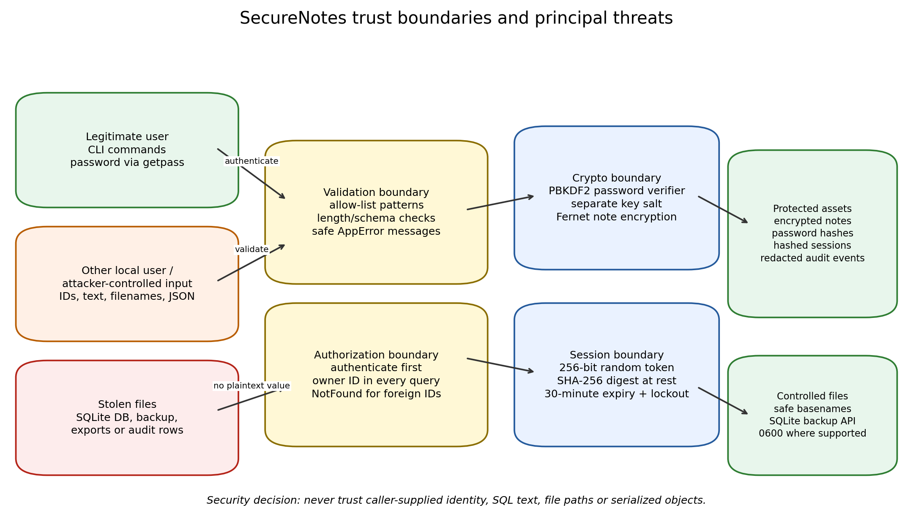

# SecureNotes threat model

## 1. Purpose and scope

This document explains what SecureNotes is trying to protect, from whom, and
under which assumptions. It was written before treating Bandit output as the
complete definition of security: a scanner can find MD5 or `pickle`, but it
cannot decide whether one application account should be able to read another
account's note by changing an ID.

### In scope

- The hardened Python package in `securenotes/` and its CLI.
- The intentionally vulnerable local baseline in `vulnerable/` as the
  “before” audit target.
- SQLite data at rest, JSON import/export, SQLite backups and audit records.
- Local accounts, passwords, sessions, note ownership and file handling.
- Attack simulations and tests that use temporary databases and harmless
  marker files.

### Out of scope

- Network/API security: SecureNotes has no server, TLS endpoint or browser UI.
- Operating-system compromise, malware, keyloggers, memory forensics and an
  attacker who can execute code as the same OS user while notes are decrypted.
- Physical coercion, shoulder surfing, cloud backup policy and full-disk
  encryption.
- Cryptographic implementation review of the third-party `cryptography`
  library itself. The project uses established primitives rather than
  inventing its own cipher.
- Multi-device sync, sharing, roles/administration and account recovery.

## 2. Assets and security objectives

| Asset | Why it matters | Main objective |
|---|---|---|
| Note titles, bodies and tags | Primary private user content | Confidentiality and integrity; only the password holder/owner can read or alter them |
| Account passwords | Gateway to authentication and note decryption | Never store/log plaintext; make offline guessing expensive |
| Password-derived encryption key | Decrypts all notes for one account | Keep only in memory after successful authentication |
| Session bearer tokens | Prove a recent login | Unpredictable, time-limited, revocable, useless if the token table leaks |
| SQLite database and backups | Contain account records, ciphertext and metadata | Owner restriction, integrity, no plaintext secrets |
| Exported JSON | Deliberately decrypted owner data | Owner-only destination and file permissions; explicit warning |
| Audit events | Support accountability/debugging | Useful metadata without becoming a secret leak |
| Local filesystem integrity | Import/export/backup operations write files | No traversal, overwrite surprises or shell execution |

## 3. Actors

### Legitimate account holder

Knows their password and should be able to manage only their own notes. A
correct password creates two separate capabilities in the current process:
identity/session creation and derivation of the note encryption key.

### Another application account

Can register/login legitimately, create their own notes and submit arbitrary
IDs, search strings, filenames and import files. This actor must not cross the
ownership boundary or turn shared functions into code execution.

### Unauthenticated local attacker

Can invoke the CLI and try usernames, passwords, malformed values and session
tokens. They should learn neither whether an account exists nor any note data.

### Person/process who obtains files

May obtain a copy of the SQLite database, backup, WAL sidecars or audit table.
They should find ciphertext, salts, password verifiers and token digests—not
passwords, usable tokens or note plaintext.

### Malicious file supplier

Can provide a JSON/pickle-shaped import file, a hostile export/backup name or
oversized content. File parsing and naming must fail closed.

### Local operator

Runs backups and controls the filesystem. A whole-database backup is treated
as an operator-level sensitive artefact even though its note fields remain
encrypted. A production multi-user deployment would normally place this
function behind an administrator/operator role.

## 4. Trust boundaries



### Boundary A — user/CLI input to application services

Inputs crossing this boundary include usernames, passwords, IDs, titles,
bodies, tags, search text, filenames and import paths. They are treated as
untrusted even when supplied by a logged-in user.

Controls:

- type checks and allow-list validation;
- maximum lengths/counts;
- password entry with `getpass`;
- safe public errors;
- control-character checks for displayed note text.

### Boundary B — authenticated identity to owned data

Possession of *an* account must not imply access to *every* account's notes.

Controls:

- an `AuthContext` is produced only after password verification;
- every note read/update/delete includes both note ID and owner ID;
- foreign and non-existent IDs produce the same `NotFoundError`;
- exports and searches start from the authenticated owner's rows only.

### Boundary C — password/key material to persistent storage

Persistent storage is assumed discloseable. Therefore secrets must be
transformed before they cross into SQLite.

Controls:

- password verifier: PBKDF2-HMAC-SHA256 with per-user salt;
- encryption key: separate per-user salt, memory-only Fernet object;
- session: random bearer token outside the DB, SHA-256 digest inside it;
- audit: metadata only.

### Boundary D — application to filesystem/OS

Export, import and backup cross into the filesystem. A filename must remain
data, never become a path escape or command.

Controls:

- safe basenames and resolved-parent checks;
- JSON-only deserialization;
- SQLite backup API rather than a shell;
- owner-only files created securely where the platform supports it;
- backups refuse to overwrite an existing destination.

## 5. Data-flow summary

```text
Password ─┬─ verifier salt ─> PBKDF2 verifier ─> users.password_hash
          └─ key salt ──────> PBKDF2 ─> Fernet key (memory only)
                                             │
Note text ───────────────────────── encrypt ─┴─> notes.*_ciphertext

secrets.token_urlsafe(32) ─> shown once to user
                  └────────> SHA-256 digest ─> sessions.token_hash
```

Password change is a special flow: notes are decrypted with the old derived
key, re-encrypted under a new salt/key, the verifier is replaced, and all old
sessions are revoked in one database transaction.

## 6. STRIDE analysis

| Category | Concrete threat in SecureNotes | Baseline weakness | Hardened response |
|---|---|---|---|
| **S**poofing | Guess a password/session or bypass login with SQL syntax | SQL injection, MD5, predictable token | Parameterized login; PBKDF2; random hashed expiring sessions; lockout |
| **T**ampering | Change/delete another user's note, overwrite an unintended file, corrupt import | IDOR, traversal, unbounded import | Owner condition on every mutation; safe paths; schema/size validation; Fernet integrity |
| **R**epudiation | User denies an action; logs either missing or too revealing | Logs expose actual secrets | Redacted audit events record user/event/outcome without content |
| **I**nformation disclosure | Read DB rows, audit logs or errors to obtain content/secrets | Plaintext notes, secret logs, SQL errors, enumeration | Encryption at rest, redaction, generic errors/messages |
| **D**enial of service | Huge notes/imports or repeated authentication work | No bounds or attempt policy | Field/file/count limits, lockout; residual lockout-DoS accepted and documented |
| **E**levation of privilege | Turn a filename/import into shell/code execution; cross from Bob to Alice | `os.system`, `pickle.load`, IDOR | No shell, JSON only, owner-scoped authorization |

## 7. Worked abuse cases

### Abuse case 1 — “I know a username, not the password”

1. Attacker submits `alice' --` as the username and any password.
2. Baseline string interpolation comments out the password predicate and
   returns Alice's row.
3. Hardened lookup binds the complete string as a username value. It matches
   no account, performs dummy PBKDF2 work and returns the generic failure.

Security property tested: input remains data; authentication cannot be
changed by punctuation.

### Abuse case 2 — “I have my own account; Alice's note is probably ID 1”

1. Bob logs in normally and requests note 1.
2. Baseline `get_note(note_id)` has no caller/owner concept and returns it.
3. Hardened query requires `id = 1 AND user_id = Bob's ID`, so no row is
   visible. Bob receives the same “Note not found” as for ID 999999.

Security property tested: authentication is not authorization.

### Abuse case 3 — “I copied the database from a backup”

1. Attacker searches raw SQLite/WAL bytes for a known secret phrase.
2. Baseline contains the phrase and an MD5 password such as
   `5f4dcc3b5aa765d61d8327deb882cf99` for `password`.
3. Hardened raw bytes contain salts, PBKDF2 verifiers, token digests and
   Fernet ciphertext; the phrase is absent.

Security property tested: database disclosure does not equal immediate data
disclosure, although offline password guessing remains possible.

### Abuse case 4 — “Import this helpful notes file”

1. Attacker supplies a pickle whose `__reduce__` invokes an OS command.
2. Baseline `pickle.load` executes the canary during deserialization.
3. Hardened import rejects non-JSON before parsing; a pickle canary never runs.

Security property tested: untrusted serialization formats must not be able to
name/call Python functions.

### Abuse case 5 — “Use this backup filename”

1. Attacker supplies `backup.db; touch /tmp/marker`.
2. Baseline concatenates it into an `os.system` string; the shell treats the
   semicolon as a second command.
3. Hardened code rejects the name and, for valid names, calls SQLite's backup
   API directly. Removing the shell is stronger than trying to escape one.

Security property tested: eliminate the interpreter boundary where possible.

## 8. Risk-rating method

The audit uses qualitative severity rather than claiming a formal CVSS score
for a local teaching application:

- **Critical** — authentication bypass or code/command execution.
- **High** — direct cross-account/plaintext disclosure or highly reusable
  credential/session compromise.
- **Medium** — information that materially assists attack, unlimited online
  guessing, or practical resource exhaustion.
- **Low** — limited metadata/usability exposure.

Ratings consider the local threat model. For example, command injection is
Critical because a filename can execute as the application/OS user, while the
20,000-character input finding is Medium because it demonstrates missing
resource policy rather than an immediate crash by itself.

## 9. Assumptions and accepted residual risks

1. **Endpoint trust:** while a correct password is entered, plaintext and the
   Fernet key exist in process memory. Malware in the same OS account is out
   of scope.
2. **Password strength remains decisive:** PBKDF2 slows guessing but cannot
   make a reused/common password safe. The application's 12-character,
   three-class policy is a floor, not a guarantee.
3. **No recovery:** losing the password loses the notes. Adding recovery
   would introduce another secret/authority and a new attack surface.
4. **Metadata remains:** usernames, timestamps, note counts and ciphertext
   sizes are visible in a stolen database.
5. **Exports are intentionally plaintext:** file permissions reduce casual
   exposure but do not make an export equivalent to the encrypted database.
6. **Whole-database backups are operator artefacts:** a future multi-user
   version should add an explicit administrator role or per-user encrypted
   backup format.
7. **Lockout trades availability for guessing resistance:** an attacker who
   knows a username can trigger a temporary lock. A networked service might
   prefer IP/device throttling and alerts; those identifiers do not exist in
   this local CLI.
8. **Deletion is logical SQLite deletion:** forensic secure erasure of every
   historical WAL/page is not promised. New note content is encrypted before
   its initial write, which prevents ordinary plaintext remnants from this
   application, but it is not a certified data-wiping tool.

## 10. Security decisions that follow from the model

- Prefer **removing dangerous interpreters** (shell/pickle) to sanitizing for
  them.
- Use **parameterization as the SQL defence**; validation is defence in depth,
  not a substitute.
- Enforce ownership **in the query**, not merely by hiding IDs in the CLI.
- Store **verifiers/digests/ciphertext**, because the database is assumed to
  be copyable.
- Fail with the **least informative safe message** on authentication and
  foreign-object access.
- Pair every blocked attack with a **legitimate workflow check**, so a control
  cannot “pass” merely by breaking the feature.
